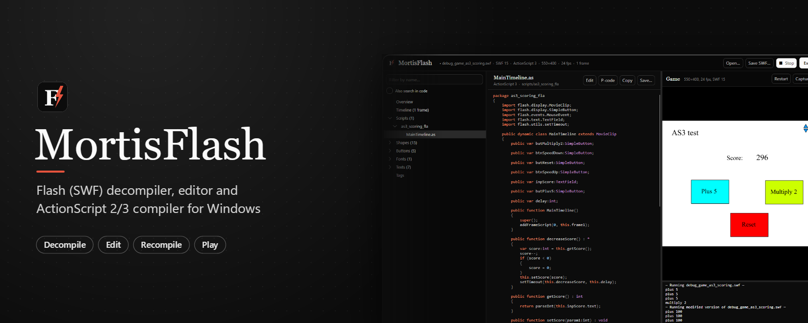
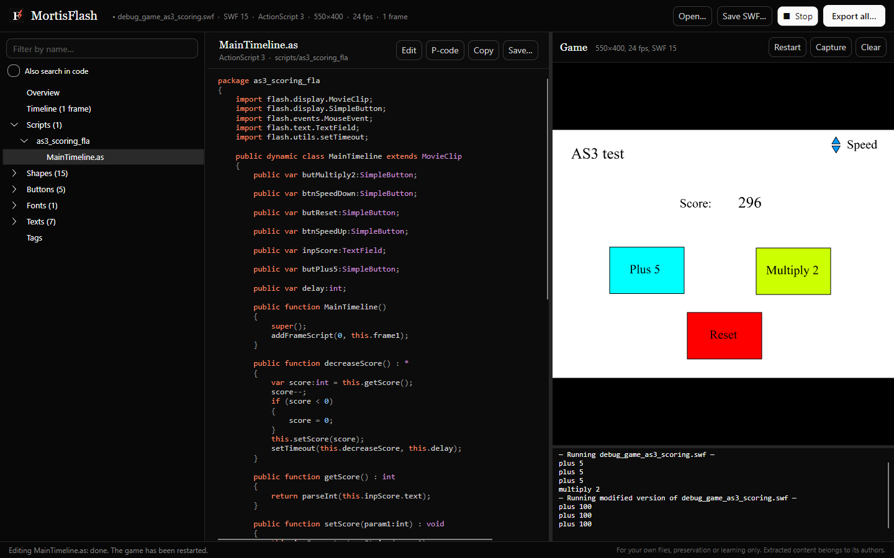
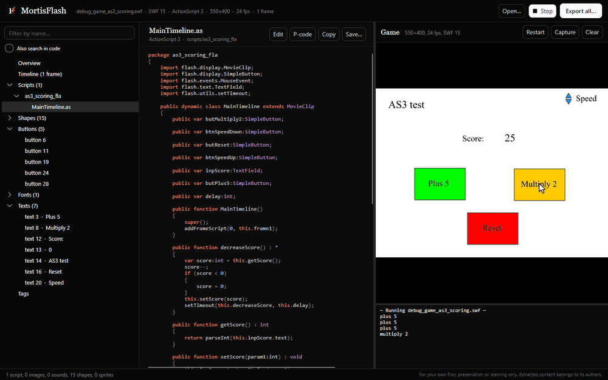
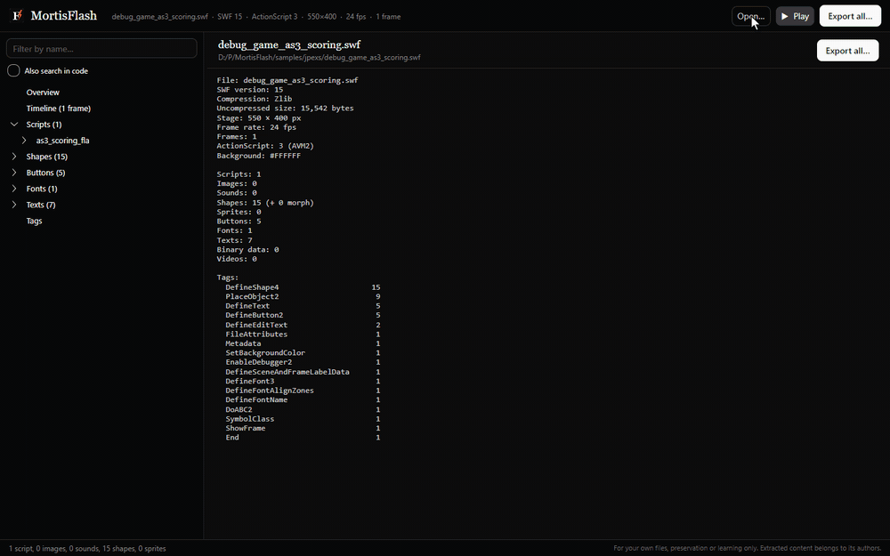
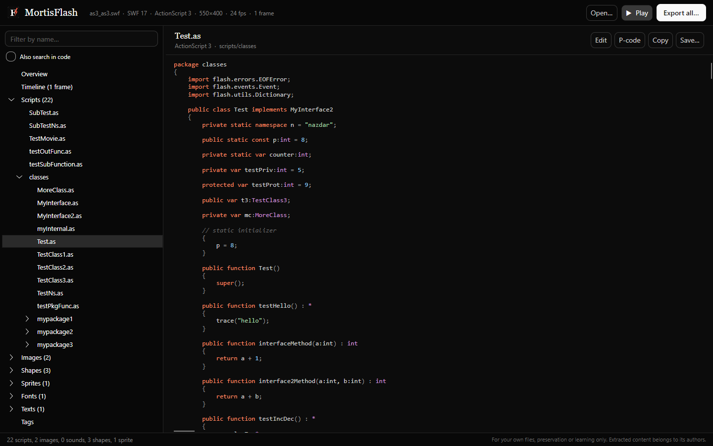
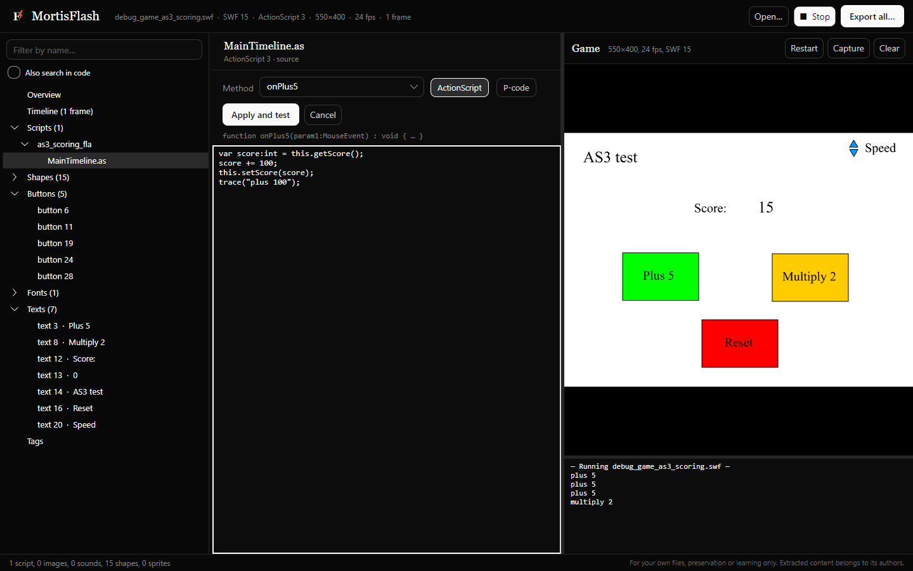
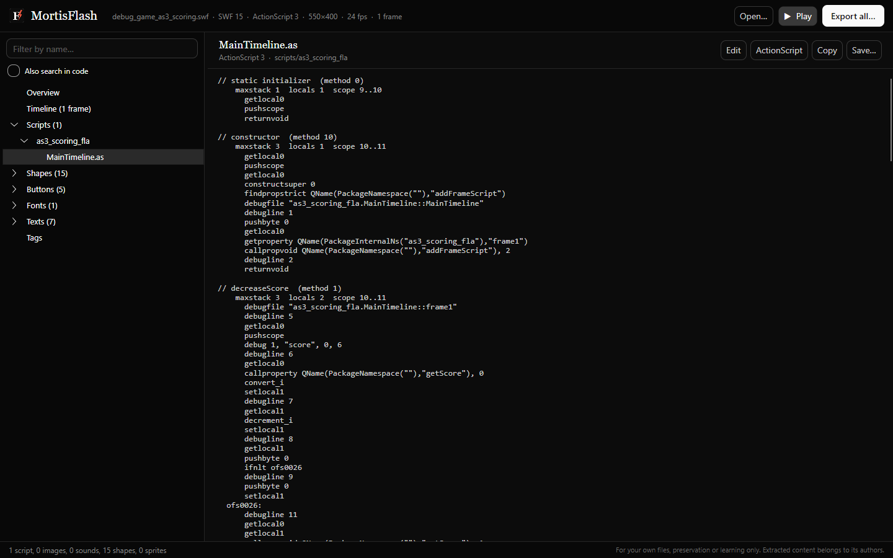
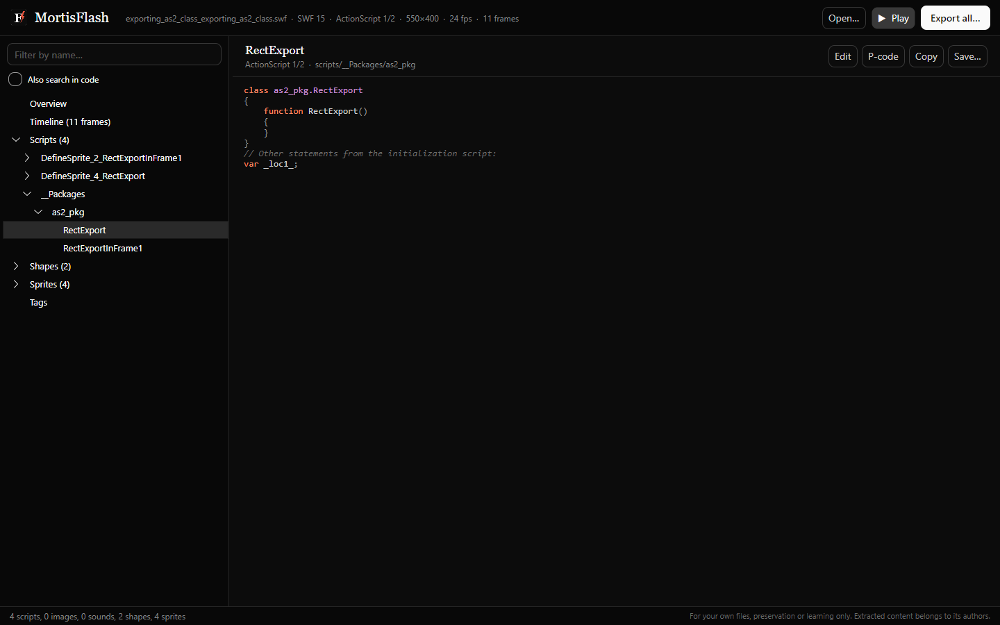
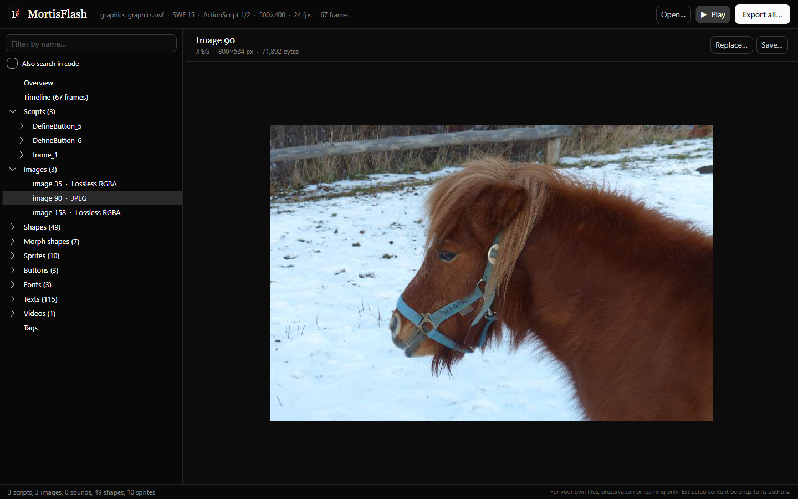
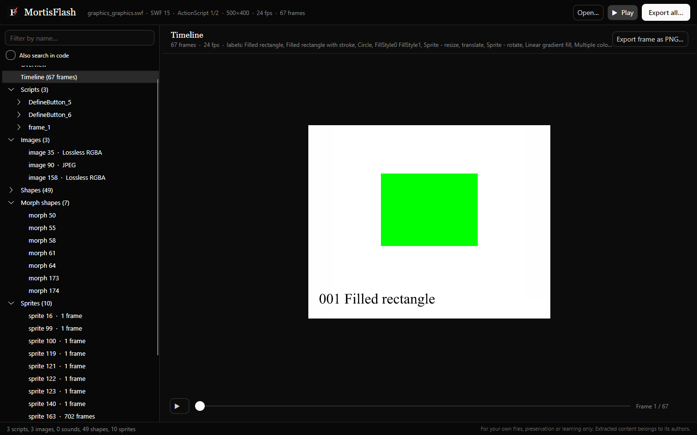

<p align="center">
  
</p>

<p align="center">
  <a href="https://github.com/Nekuzaky/Mortis-flash-decompiler/releases/latest"></a>
  <a href="https://github.com/Nekuzaky/Mortis-flash-decompiler/releases"></a>
  <a href="https://github.com/Nekuzaky/Mortis-flash-decompiler/actions/workflows/build.yml"></a>
  
  
  
  
  <a href="LICENSE"></a>
</p>

<p align="center">
  <b>Open a Flash game, read its code, change it and play the result, all in one window.</b><br>
  MortisFlash decompiles SWF files and Flash projectors to readable ActionScript 1, 2 and 3, extracts every asset,<br>
  recompiles your edits with its own built-in compilers and runs the game instantly with an embedded Ruffle player.
</p>

<p align="center">
  <a href="https://github.com/Nekuzaky/Mortis-flash-decompiler/releases/latest"><b>Download for Windows</b></a> ·
  <a href="#features">Features</a> ·
  <a href="#see-it-in-action">Demo</a> ·
  <a href="#documentation">Documentation</a> ·
  <a href="#build-from-source">Build from source</a> ·
  <a href="CHANGELOG.md">Changelog</a>
</p>

<p align="center">
  
</p>

> **Use responsibly.** Only decompile files you own or have permission to analyze, or for preservation and learning.
> Extracted code and assets remain the property of their authors; do not redistribute them.

## Download

Download **`MortisFlash-<version>-win-x64.exe`** from the [latest release](https://github.com/Nekuzaky/Mortis-flash-decompiler/releases/latest)
and run it. It is a single portable executable: nothing to install or unzip, and .NET does not need to be present.
The command-line tool is available on the same page as **`mflash-<version>-win-x64.exe`**.

- **Requirements:** Windows 10 or 11, 64-bit. The embedded game player uses the Microsoft Edge WebView2 runtime, which
  ships with Windows 11 and most up-to-date Windows 10 installations. If it is missing, the game panel links to
  Microsoft's installer; browsing, exporting and editing work without it.
- **SmartScreen:** the executables are not code-signed, so Windows may show *Windows protected your PC* on first launch.
  Choose **More info**, then **Run anyway**.

## Features

| Area | What you get |
|---|---|
| **ActionScript 3** (AVM2) | Packages, classes, interfaces, namespaces, fields with initializers, constructors, getters and setters, metadata and imports. `if`/`else`, `while`, `do…while`, `for`, `for…in`, `for each`, `switch`, `try`/`catch`/`finally`, `&&`/`\|\|`, ternaries and closures are rebuilt. Debug names are used when present. |
| **ActionScript 1/2** (AVM1) | Frame scripts, sprite timelines, `onClipEvent` and `on()` handlers, buttons, `DoInitAction`, and AS2 classes rebuilt as `class X extends Y { … }` with accessors and statics. |
| **Source editing** | Edit the decompiled code and recompile it: AS3 one method body at a time, AS1/AS2 whole scripts and AS2 classes. The compilers are built in; no Flex SDK, Animate or Java is needed. |
| **P-code** | A bytecode listing for every script, viewable and editable, for anything the compilers do not cover. |
| **Live testing** | The game runs inside the app (Ruffle through WebView2), restarts after every change and streams its `trace()` output to a console. |
| **Images** | JPEG (tables merged, broken markers repaired), JPEG with alpha, lossless 8/15/24/32-bit, PNG and GIF. Export to PNG or JPEG, replace with PNG, JPEG or GIF. |
| **Sounds** | MP3 kept as is, PCM and ADPCM decoded to WAV, stream sounds rebuilt. Replace event sounds and stream sounds with MP3 or WAV. |
| **Vector graphics** | Shapes and morph shapes exported to SVG with gradients and bitmap fills; sprites, buttons and texts rendered to PNG. |
| **Timeline** | Frame-by-frame rendering with masks, color transforms and morphs, with playback in the app. |
| **Fonts and texts** | Glyph sheets, embedded OpenType fonts, static and dynamic texts. Text fields and static texts can be edited. |
| **Other data** | Binary data with type detection (nested SWFs open in place), video streams exported to FLV, full tag list. |
| **Containers** | `FWS`, `CWS` (zlib) and `ZWS` (LZMA) files, and Flash projector executables (`.exe`). |
| **Command line** | `mflash` exports, prints scripts and renders frames from scripts and build pipelines. |

## See it in action

**Edit a method, apply, and the game restarts with the new code.** Here `score += 5` becomes `score += 100`:

<p align="center">
  
</p>

**Browse the scripts and assets, then play the game with its console:**

<p align="center">
  
</p>

The complete 46-second walkthrough is available as a video: [mortisflash-demo.mp4](docs/media/mortisflash-demo.mp4).

## Screenshots

<table>
  <tr>
    <td width="50%"></td>
    <td width="50%"></td>
  </tr>
  <tr>
    <td align="center"><sub>Decompiled ActionScript 3 with syntax highlighting</sub></td>
    <td align="center"><sub>Source editor: pick a method, change it, apply and test</sub></td>
  </tr>
  <tr>
    <td width="50%"></td>
    <td width="50%"></td>
  </tr>
  <tr>
    <td align="center"><sub>P-code listing, editable as well</sub></td>
    <td align="center"><sub>ActionScript 2 classes rebuilt from prototype code</sub></td>
  </tr>
  <tr>
    <td width="50%"></td>
    <td width="50%"></td>
  </tr>
  <tr>
    <td align="center"><sub>Images, ready to export or replace</sub></td>
    <td align="center"><sub>Timeline rendering and playback</sub></td>
  </tr>
</table>

<sub>The files shown are samples from the test suite of the JPEXS Free Flash Decompiler project.</sub>

## Quick start

1. **Open** a `.swf` file or a Flash projector `.exe`: drop it on the window, or use **Open…** (`Ctrl+O`).
2. **Browse** the tree on the left. **Filter by name** (`Ctrl+F`) narrows it down; **Also search in code** decompiles
   every script and keeps those that contain the text.
3. **Play** opens the game panel. `F5` restarts the game, **Capture** saves a screenshot, and the console shows
   everything the game traces.
4. **Edit** a script, a text, an image, a sound or binary data. Each change rewrites the SWF and restarts the game.
5. **Save SWF…** (`Ctrl+S`) writes the modified file. **Export all…** extracts everything to a folder.

The [user guide](docs/user-guide.md) and the [editing guide](docs/editing.md) cover every view and option.

## Command line

```bash
mflash info    game.swf                     # version, compression, counts, tag statistics
mflash scripts game.swf [filter] [--pcode]  # print decompiled scripts or their p-code
mflash export  game.swf [folder] [parts]    # export everything, or only some parts
mflash frame   game.swf 12 frame12.png      # render one frame of the timeline
mflash sheet   game.swf sheet.png           # contact sheet of the timeline
```

Parts: `scripts`, `pcode`, `images`, `sounds`, `shapes`, `sprites`, `fonts`, `texts`, `binary`, `videos`, `frames`.
See the [command-line reference](docs/command-line.md).

## Documentation

| Guide | Contents |
|---|---|
| [User guide](docs/user-guide.md) | Installing, opening files, the window, browsing, playing, exporting, shortcuts |
| [Editing guide](docs/editing.md) | Replacing assets, editing texts, editing scripts in ActionScript or p-code, a worked example |
| [Command line](docs/command-line.md) | Every `mflash` command, its arguments and its output |
| [Architecture](docs/architecture.md) | How the decompilers, compilers, editor and player fit together |
| [Building](docs/building.md) | Building, running and publishing from source |

## How it works

MortisFlash is a self-contained engine written from scratch in C#; it does not wrap JPEXS, Flex or any Java tool.

- **Decompilation.** The AVM1 and AVM2 decompilers share one structuring engine: control flow graph, dominators and
  post-dominators, natural loops and short-circuit condition merging, followed by cleanup passes. Code that cannot be
  structured is printed with `§§goto` markers rather than rejected.
- **Compilation.** A parser turns ActionScript into the same syntax tree the decompiler prints. Two compilers turn it
  into p-code, and the assemblers turn the p-code into bytecode. In AS3, names that are not local are resolved at run
  time through the class's namespace set, as the Flex compiler does for untyped code, so a method body compiles without
  the rest of the project.
- **Verification.** A development self-test checks that every ABC block is rewritten byte for byte and that every script
  survives disassemble → assemble and decompile → compile → decompile round trips. On the test suite, among the scripts
  that compile, about 96 % of AS3 method bodies and 85 % of AS2 scripts come back identical; most of the others are
  equivalent rewrites such as `i = i + 1` → `i++`.

Read the [architecture notes](docs/architecture.md) for details.

## Limitations

- Encrypted SWFs (for example Harman AIR encryption) cannot be opened.
- Filters and blend modes are not drawn in previews; the embedded player shows them.
- The compilers do not support E4X, `with` in AS3, or closures that capture local variables of the enclosing AS3
  method. Scripts the decompiler prints with `§§` placeholders cannot be recompiled from source either. P-code mode
  covers all of these cases.
- Stream sounds can be replaced with MP3 at 11, 22 or 44 kHz, or 16-bit PCM WAV. Static texts can only use the
  characters embedded in their font.

## Build from source

Requires the [.NET 10 SDK](https://dotnet.microsoft.com/download) on Windows.

```bash
git clone https://github.com/Nekuzaky/Mortis-flash-decompiler.git
cd Mortis-flash-decompiler
dotnet build MortisFlash.slnx
dotnet run --project src/MortisFlash
```

Warnings are treated as errors and the .NET analyzers are enabled. To publish the portable executables, see
[Building](docs/building.md).

```
src/MortisFlash.Core   Engine: SWF reader and writer, assets, AVM1 and AVM2 decompilers, compilers, assemblers, renderer, exporter
src/MortisFlash.Cli    mflash command-line tool
src/MortisFlash        Avalonia desktop app, embedded Ruffle player
docs/                  Guides, screenshots and demo media
```

## Support the project

MortisFlash is free and open source. If it saved you time, you can support its development:

- [GitHub Sponsors](https://github.com/sponsors/Nekuzaky)
- [Patreon](https://www.patreon.com/Nekuzaky)
- [Buy Me a Coffee](https://www.buymeacoffee.com/Nekuzaky)

Bug reports and feature requests are welcome in the [issue tracker](https://github.com/Nekuzaky/Mortis-flash-decompiler/issues);
see [CONTRIBUTING.md](CONTRIBUTING.md) before opening a pull request.

## Acknowledgements

- [Ruffle](https://ruffle.rs), the Flash Player emulator embedded for playback (MIT / Apache-2.0).
- [Avalonia](https://avaloniaui.net) and [SkiaSharp](https://github.com/mono/SkiaSharp) for the interface and rendering.
- The [JPEXS Free Flash Decompiler](https://github.com/jindrapetrik/jpexs-decompiler) project, whose public test
  files were used to test MortisFlash and appear in the screenshots.

Third-party licenses are listed in [THIRD_PARTY_NOTICES.md](THIRD_PARTY_NOTICES.md).

## License

MortisFlash is released under the [MIT License](LICENSE). Copyright © 2026 Nekuzaky.

Adobe Flash and ActionScript are trademarks of Adobe Inc. MortisFlash is an independent project and is not affiliated
with or endorsed by Adobe.
