# Architecture

This document describes how MortisFlash is organized and how its main pipelines work: reading SWF files, decoding
assets, decompiling and compiling ActionScript, editing, rendering, and the desktop application with its embedded
player. It is intended for contributors; build instructions are in [building.md](building.md).

## Solution layout

```
MortisFlash.slnx               solution (three projects)
Directory.Build.props          shared settings: net10.0, nullable, warnings as errors, analyzers, version
Directory.Packages.props       central package versions (Avalonia, SkiaSharp, WebView2)
src/
    MortisFlash.Core/          engine, class library (depends on SkiaSharp only)
        Swf/                   container, LZMA decoder, binary reader, writer, tag codes
        Assets/                images, sounds, shapes, fonts and texts, timeline records, video
        Avm1/                  AVM1 parser and disassembler, decompiler, assembler, AS2 class builder
        Avm2/                  ABC model, reader and writer, opcodes, names, method decompiler, printer, assembler
        Decompiler/            shared AST, control-flow graph, structurer, simplifier, declarations, code writer
        Compiler/              lexer, parser, AVM1 and AVM2 compilers
        Rendering/             SkiaSharp renderer, SVG exporter
        Export/                folder export and file summary
        Edit/                  every modification of a SWF
        SwfDocument.cs         document model
    MortisFlash.Cli/           mflash command-line tool
    MortisFlash/               Avalonia desktop application
        Controls/              CodeView, FlashPlayerView, MortisTheme
        Ruffle/                Ruffle web build and player.html, embedded as resources
samples/                       test SWFs (git-ignored)
dist/                          publish output (git-ignored)
```

`MortisFlash.Cli` and `MortisFlash` both reference `MortisFlash.Core`; the engine has no dependency on the UI. The
namespaces follow the folders: `MortisFlash.Swf`, `MortisFlash.Assets`, `MortisFlash.Avm1`, `MortisFlash.Avm2`,
`MortisFlash.Decompiler`, `MortisFlash.Compiler`, `MortisFlash.Rendering`, `MortisFlash.Export`, `MortisFlash.Edit`.

## Pipelines at a glance

```mermaid
flowchart TD
    subgraph dec [Decompilation]
        d1["SWF file or projector"] --> d2["SwfFile: extraction, decompression, tags"]
        d2 --> d3["SwfDocument: assets and script list"]
        d3 --> d4["AVM2: AbcFile.Parse, Opcodes.Disassemble"]
        d3 --> d5["AVM1: Avm1Parser.Parse"]
        d4 --> d6["MethodDecompiler: basic blocks, try regions"]
        d5 --> d7["Avm1Decompiler: basic blocks, switch detection"]
        d6 --> d8["Cfg: dominators, post-dominators, natural loops"]
        d7 --> d8
        d8 --> d9["Structurer: if, loops, switch, try, break, continue"]
        d9 --> d10["Simplifier, PostProcess, Declarations"]
        d10 --> d11["Shared AST"]
        d11 --> d12["As3Printer or As2ClassBuilder, then CodeWriter"]
    end
    subgraph cmp [Compilation and editing]
        c1["Edited ActionScript"] --> c2["Lexer and Parser"]
        c2 --> c3["Shared AST"]
        c3 --> c4["Avm1Compiler: whole AS1/AS2 script"]
        c3 --> c5["Avm2Compiler: one AS3 method body"]
        c4 --> c6["P-code text"]
        c5 --> c6
        c7["Edited p-code"] --> c6
        c6 --> c8["Avm1Assembler or Avm2Assembler"]
        c8 --> c9["SwfEditor: splice action bytes, or AbcWriter rewrites the DoABC tag"]
        c9 --> c10["SwfWriter.Write, then SwfFile.Parse into a new SwfDocument"]
    end
```



The decompilers and the compilers meet on the same syntax tree (`Decompiler/Ast.cs`): the compilers' parser
produces the nodes that the decompilers print, so decompiled code can be edited and compiled back. Both directions
also meet on the p-code text: the format the disassemblers print is the format the assemblers read, and the
compilers emit p-code text rather than bytes.

## Document model

`SwfDocument` is the in-memory view of a file. Its constructor scans every tag, including the tags inside sprites:

- symbol names (`ExportAssets`, `SymbolClass`), `JPEGTables`, the background color, the frame labels of the main
  timeline, and a map of characters by ID;
- images, event sounds, shapes, morph shapes, sprites, buttons, fonts (completed by `DefineFontInfo`), texts, binary
  data (with type detection, `DetectExtension`) and videos;
- stream sounds, one per timeline (main timeline and each sprite);
- scripts: one `ScriptItem` per AS3 unit of each `DoABC`/`DoABC2` tag, and one per AS1/AS2 action block (frame
  actions of the main timeline and of sprites, `DoInitAction`, clip event handlers, button handlers).

Errors never interrupt the scan: each step runs through `Try`, which records the message in `Errors` (shown as
Warnings in the application, printed to the standard error stream by `mflash`, written to `errors.txt` by the
exporter). Expensive work is deferred and cached: images are decoded, scripts decompiled and p-code generated on
first access. `ScriptItem.Code` turns a decompilation failure into a comment instead of an exception.

A `ScriptItem` knows where its code lives so that it can be replaced: `As3` holds the `As3Unit` (ABC file and class
or script index), and `As2` holds an `As2Location` (tag, offset and length of the actions, and for clip and button
handlers the size field to update).

## SWF container layer (Swf/)

- `SwfFile.ExtractFromContainer` accepts a SWF (`FWS`, `CWS` or `ZWS` signature with a plausible version) or a file
  that contains one. Flash projectors are recognized by their footer: the `0xFA123456` signature followed by the
  length of the SWF appended to the executable. Otherwise the data is scanned for a SWF signature with a plausible
  length. A lowercase signature (`fWS`, `cWS`, `zWS`) identifies a SWF encrypted by the Harman AIR SDK, which is
  rejected with an explicit message.
- `SwfFile.Parse` decompresses the body: zlib for `CWS` (a truncated stream is read as far as possible and reported
  as a warning), LZMA for `ZWS` (`Lzma.cs`, a decoder for the LZMA1 format written from the reference specification,
  decoding in memory to the size given by the header). It rebuilds an uncompressed `FWS` image of the file, reads the
  stage rectangle, frame rate and frame count, then splits the tags into `SwfTag` objects: code, raw data, offset,
  parent, child tags for `DefineSprite`, and any bytes found after a sprite's `End` tag (`Tail`), which are written
  back unchanged. A tag that extends past the end of the file stops the parsing with a warning.
- `SwfReader` reads little-endian integers, bit fields (`UB`, `SB`, `FB`), the common records (`RECT`, `MATRIX`,
  `CXFORM`), strings (UTF-8 from SWF 6, ANSI before) and AVM1 doubles.
- `SwfWriter.Write` serializes the tags after the original header fields. It uses the short tag header for data
  shorter than 63 bytes, except for bitmap tags and `SoundStreamBlock`, which keep the long form as Flash writes them.
  Sprites are rebuilt from their child tags and tail, and an `End` tag is added if missing. The original compression
  is kept, except that LZMA becomes zlib (there is no LZMA encoder) and files older than SWF 6 are written
  uncompressed.
- `TagCodes` holds tag names and the category tests (`IsImage`, `IsShape`, `DefinesCharacter`, and so on).

## Asset decoders (Assets/)

| File | Content |
|---|---|
| `Images.cs` | `ImageDecoder`: `DefineBits` with `JPEGTables` merged, JPEG streams cleaned of stray SOI/EOI markers, `DefineBitsJPEG2` holding JPEG, PNG or GIF data, JPEG with an alpha channel (`DefineBitsJPEG3/4`) converted to PNG, lossless bitmaps converted to PNG. Bitmaps are decoded on demand. |
| `Sounds.cs` | `SoundDecoder`: MP3 kept as is, PCM and ADPCM decoded to WAV, Nellymoser and Speex kept raw; stream sounds rebuilt from `SoundStreamHead` and the `SoundStreamBlock` tags of their timeline. |
| `Shapes.cs` | `ShapeParser` for `DefineShape` 1 to 4 and font glyphs: fill and line styles, edge records converted into closed contours per fill style; `SwfMorphShape` keeps both states for interpolation. |
| `Fonts.cs` | `FontParser` (`DefineFont` 1 to 4, `DefineFontInfo`), `TextParser` (`DefineText`, `DefineText2`, `DefineEditText`), HTML stripping for previews. Offsets of the editable parts are recorded for the editor. |
| `Timeline.cs` | `PlaceObject` (including clip actions), `SwfButton` (records and `on(...)` handlers), `EventActions` with the location of each handler's bytes and size field. |
| `Video.cs` | `VideoExtractor` rebuilds an FLV file from a `DefineVideoStream` and its `VideoFrame` tags. |

## Shared decompiler infrastructure (Decompiler/)

- `Ast.cs`: expressions and statements shared by both virtual machines and by the compilers. Each node writes itself
  to a `CodeWriter` with operator precedence handling.
- `Cfg.cs`: control-flow graph built from basic blocks provided by each VM. It computes dominators (iterative
  Cooper, Harvey and Kennedy algorithm; exception handlers are reached through virtual edges from the blocks they
  cover), post-dominators relative to a virtual exit, and natural loops.
- `Structurer.cs`: rebuilds control structures from the graph. Branches of an `if` join at the immediate
  post-dominator (restricted to the enclosing structure), conditions spread over several blocks by `&&` and `||` are
  merged back into one expression, loops are natural loops, `switch` and `try` regions come from the VM, and the
  remaining jumps become `break` or `continue`, labeled when needed. A block that cannot be placed is
  emitted as `§§goto(addrXXXX);`. A missing stack value is shown as `§§pop()`. The structurer drives the translation:
  each VM implements `IBlockTranslator`, which turns a block's instructions into statements while propagating a
  symbolic stack (`SymState`).
- `Simplifier.cs`: cleanup passes: `while (true)` loops turned into `while`, `do … while` or `for`, redundant `else`
  after a jump removed, nested `if` merged into `&&`, `x = x + 1` turned into `x++` and `x = x op y` into `x op= y`,
  superfluous `continue` and `return` removed.
- `Declarations.cs`: places `var` declarations once the method is fully structured: the first assignment of each local
  becomes its declaration, and locals only written inside expressions are declared at the top.
- `CodeWriter.cs`: indented output (braces on their own line) plus a list of tokens (keyword, identifier, string,
  number, comment, type, punctuation) used for syntax highlighting. `SafeName` wraps invalid identifiers in `§…§`,
  following the JPEXS convention.

## AVM2 pipeline (ActionScript 3)

1. `AbcFile.Parse` (`Abc.cs`) reads the constant pools (integers, unsigned integers, doubles, the float pool of
   ABC 47.16 and later, strings, namespaces, namespace sets, multinames), methods, metadata, instances, classes,
   scripts and method bodies. It keeps the details needed to write the file back byte for byte, such as the string
   index of each namespace name.
2. `As3Printer.Units` splits an ABC file into units: one per class, one per package-level definition, and one per
   script without traits. Each unit becomes a `.as` script.
3. `MethodDecompiler` decompiles one method body: `Opcodes.Disassemble` produces the instructions, block leaders come
   from branch targets, branches and exception ranges, and try regions are derived from the exception table. As the
   block translator, it rebuilds expressions from the operand stack, names locals from debug information when present,
   recognizes the activation object used by closures, and handles the AVM2 idioms.
4. `Cfg`, `Structurer`, then `Simplifier`, a VM-specific `PostProcess` (for example `for … in` and `for each` loops
   rebuilt from `hasnext2` loops, and the comparison cascade generated by the ASC compiler for `lookupswitch` turned
   back into `switch`), `Simplifier` again, and `Declarations`.
5. `As3Printer` lays out the file: package, imports (collected by `NameContext` while names are printed), class
   header (`dynamic`, `final`, `extends`, `implements`), metadata, fields (with initializers moved up from the static
   and instance constructors), constructor, methods and accessors, namespace declarations.

`NameContext` (`Names.cs`) formats multinames for source code (short names, packages, imports, access modifiers) and
for p-code (`Describe`, the textual form read back by `Avm2Assembler`). `As3Printer.PCodeOf` prints a method's
p-code, with `ofsXXXX:` labels on jump targets and `try` lines for exception handlers.

## AVM1 pipeline (ActionScript 1 and 2)

1. `Avm1Parser.Parse` (`Avm1Actions.cs`) decodes the actions, resolves constant pool references, and nests the bodies
   of `DefineFunction`, `DefineFunction2`, `With` and `Try` under their action. `Disassemble` prints the p-code with
   `locXXXX:` labels.
2. `Avm1Decompiler` builds the basic blocks, detects the comparison cascades that encode `switch`, and translates
   actions with a symbolic stack, registers and variables. Functions are decompiled recursively.
3. The shared `Cfg`, `Structurer`, `Simplifier` and `Declarations` passes follow, with an AVM1 `PostProcess`.
4. For `DoInitAction` scripts under `__Packages`, `As2ClassBuilder` rebuilds the `class` syntax (constructor,
   `extends`, `implements`, methods, accessors, static and instance fields) from the prototype-based code emitted by
   the Flash compiler.

`SwfDocument` adds the `on(...)` or `onClipEvent(...)` wrapper around clip and button handlers.

## Compilers (Compiler/)

- `Lexer` tokenizes ActionScript 1, 2 and 3. It accepts the `§name§` identifiers printed by the decompiler, and
  rejects the `§§` placeholders with a message that recommends p-code editing.
- `Parser` is a recursive-descent parser. `ParseScript` parses a whole AS1/AS2 script and reports an outer
  `on(...)` or `onClipEvent(...)` wrapper separately; `ParseBody` parses an AS3 method body. It produces the shared
  AST plus a few compiler-only nodes (type arguments, AS2 `class` declarations, prototype-style `extends` and
  `implements` statements), and records the source line of each node for error messages (`CompileException`).
- `Avm1Compiler` translates the AST into AVM1 p-code text. It builds a `ConstantPool` from the strings used (within
  the format's size limits), keeps loop and `switch` temporaries in registers (the four global registers, or the
  registers of `DefineFunction2` inside functions from SWF 7), and compiles AS2 class declarations to prototype code.
- `Avm2Compiler` compiles one method body; the method's signature and the class traits are not changed. Parameters
  and `var` declarations are allocated to registers, with `debug` instructions that keep their names. Names that are
  not locals become run-time multinames resolved through a namespace set made of the class's private, protected and
  internal namespaces and every package namespace of the ABC, as the Flex compiler does for untyped code, so a method
  compiles without the rest of the project. The generated p-code refers to pool entries with `#mnN` and uses `L0`,
  `L1`, … labels. `finally` blocks are replayed on every exit path. Nested functions are added to the ABC as new
  methods and created with `newfunction`; they cannot capture the enclosing method's locals.
- `Avm1Assembler` reads AVM1 p-code: labels, nested `{ … }` blocks whose sizes are back-patched, jumps resolved on
  absolute addresses, and pushed strings encoded as references to the current `ConstantPool` when present.
- `Avm2Assembler` reads AVM2 p-code in two passes (jumps always use 4 bytes, so addresses are known before labels are
  resolved), interns missing constants into the pools, and recomputes the maximum stack size, scope depth and local
  count by flow analysis, never going below the original values.
- `AbcWriter` serializes an `AbcFile`; it is the exact inverse of `AbcFile.Parse`.

## Editing flow (Edit/)

Every modification goes through `SwfEditor`; the application never patches bytes itself.

1. An operation changes tags of the current document: `ReplaceImage`, `ReplaceSound`, `ReplaceStreamSound`,
   `ReplaceBinary`, `SetEditText`, `SetStaticText`, `ReplaceAs2` and `CompileAs2` (the new action bytes are spliced
   at the script's `As2Location`, and the handler size field is updated), `ReplaceAs3Method` and `CompileAs3Method`
   (the method body is replaced, then `AbcWriter` rewrites the `DoABC`/`DoABC2` tag, keeping its flags and name).
2. `SwfEditor.Rebuild` writes the whole file with `SwfWriter`, parses the result and builds a new `SwfDocument`
   marked as modified. What the application then displays, plays and saves are exactly these bytes.

In the application, `MainWindow.ApplyEdit` runs both steps on a background thread, keeps the tree selection, and
restarts the player. If an operation throws, the document is rebuilt from the previous bytes, so a failed edit leaves
nothing half-applied.

## Rendering and export

- `SwfRenderer` is a software renderer based on SkiaSharp. It builds the display list of a timeline at a given frame
  from the `PlaceObject` and `RemoveObject` tags, and draws shapes, morph shapes (by ratio), static texts, buttons and
  sprites with their matrices and color transforms, and masks (clip depth). ActionScript is not executed, and filters
  and blend modes are not applied. Nesting is limited to a fixed depth.
- `SvgExporter` converts a shape to SVG, including gradients and bitmap fills.
- `SwfExporter.Export` writes everything, or the selected `ExportParts`, to a folder (the layout is described in
  [command-line.md](command-line.md#export-folder-layout)) and reports progress and errors; `SwfExporter.Info` produces
  the file summary used by the Overview page, `mflash info` and `info.txt`.

## Desktop application (src/MortisFlash)

- `Program.cs` forces the en-US culture, takes the first command-line argument that is an existing file, and starts
  Avalonia.
- `App.axaml` defines the Mortis theme on top of the Fluent theme: dark monochrome palette, white primary action,
  serif headings, monospaced code font. `Controls/MortisTheme.cs` holds the same palette for code and applies the
  accent color.
- `MainWindow.axaml` and `MainWindow.axaml.cs`: layout, file opening (dialog, drag and drop, start-up file), tree
  construction, name filter (debounced) and code search (parallel decompilation with cancellation), previews, frame
  playback, export, and the stack of parent documents for nested SWFs. Long operations run with `Task.Run`, and a
  selection token discards results that arrive after the selection has changed.
- `MainWindow.Edit.cs`: game panel, `ApplyEdit`, the replace actions, the text editor, the script editor
  (ActionScript and p-code modes), and selection preservation across reloads.
- `Controls/CodeView.cs` displays code in a selectable text block colored from the `CodeWriter` tokens (plain text
  beyond 300,000 characters).

### Embedded player (Controls/FlashPlayerView.cs)

`FlashPlayerView` is an Avalonia `NativeControlHost` that creates a Win32 child window and hosts a WebView2
controller in it (only `Microsoft.Web.WebView2.Core` is used; the package's WPF and WinForms references are removed
by an MSBuild target in the project file). The page and the game are served from memory through
`WebResourceRequested`:

- `https://player.mortisflash/` serves Ruffle and `player.html`, read from the executable's embedded resources named
  `Ruffle/<file>`. The player is reported unavailable when not running on Windows or when `Ruffle/ruffle.js` is missing.
- `https://game.mortisflash/current.swf` serves the current SWF bytes (a version number in the query string defeats
  caching). Any other path on this host is resolved against the folder of the opened file, without leaving it.
- Navigation away from the player host is cancelled and new windows are refused, so links opened by the game do
  nothing; `player.html` also sets Ruffle's `openUrlMode` to `deny`.
- `player.html` creates the Ruffle player and sends messages to the host with `chrome.webview.postMessage`, as JSON
  objects `{ type, text }`: `ready`, `loaded` (stage size, frame rate, version), `trace` (forwarded from Ruffle's
  `traceObserver`, which is re-attached after loading) and `error`. The host also raises `missing-runtime` when the
  WebView2 runtime is not installed.
- The WebView2 environment uses `%LOCALAPPDATA%\MortisFlash\WebView2` as its user data folder and the
  `--autoplay-policy=no-user-gesture-required` option so that game audio starts without a click.

## Testing

There is no unit-test project. Development testing relies on the JPEXS test SWFs kept in `samples/` (see
[building.md](building.md#test-swf-files)), opened in the application and processed with `mflash`.

`mflash selftest <file>` is a hidden command that exists for development. It checks, for one file:

- that writing the SWF and reading it back gives the same tags;
- that each ABC block is rewritten byte for byte by `AbcWriter` (and parses back consistently);
- p-code round trips: every AS3 method and every AS1/AS2 action block is disassembled, assembled and disassembled
  again, and the two listings are compared;
- source round trips: every AS2 script and every AS3 method body is decompiled, compiled and decompiled again, and the
  two sources are compared, ignoring whitespace. The command reports how many are identical, different or fail to
  compile.

After changing the decompiler, comparing the output of `mflash scripts` on the test files before and after the change
(for example the number of `§§goto` lines) shows regressions quickly.

## Coding rules

- Warnings are errors (`TreatWarningsAsErrors`) and the .NET analyzers run at the latest analysis level
  (`AnalysisLevel` set to `latest`). Nullable reference types are enabled. A build must produce zero warnings.
- Loops and recursion are bounded, so that malformed or hostile input cannot hang or crash the application. Examples:
  the structurer has a step budget, dominator and flow-analysis loops have iteration guards, nested AVM1 bodies are
  parsed to a fixed depth, nested AS2 functions are decompiled and compiled to a fixed depth, and the renderer limits
  nesting.
- Malformed input is reported, not thrown: the scan of a document collects errors per item, and a script or method
  that fails to decompile becomes a comment.
- Package versions are managed centrally in `Directory.Packages.props`; the Avalonia packages must keep the same
  version.
- User interface text, command-line output, code comments and documentation are in English. Both executables force
  the en-US culture so that numbers are formatted the same way on every system.

## See also

- [User guide](user-guide.md)
- [Editing a SWF](editing.md)
- [Command-line tool](command-line.md)
- [Building](building.md)
- [Project README](../README.md)
